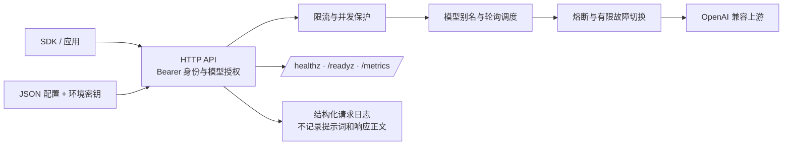

# AI Gateway

一个面向生产落地的 AI 网关 MVP：提供 OpenAI 兼容入口，集中处理客户端身份、模型白名单、RPM 限流、并发保护、模型别名、多部署轮询、故障切换、熔断、流式转发和基础指标。

当前 MVP 使用静态 JSON 配置和单进程内存状态，目的是先稳定一条模型请求链路。它保留了后续接入 Redis、配置控制面、成本账本和策略审计的边界。

## 架构



## 已实现

- `POST /v1/chat/completions`：OpenAI Chat Completions 请求格式，支持非流式和 SSE 流式响应。
- `GET /v1/models`：按客户端权限返回可用模型别名。
- `GET /healthz` 和 `GET /readyz`：容器探针。`/readyz` 在实例开始排空后返回 503，因此关停中的副本不再接收新流量。
- `GET /upstreams`：各供应商的熔断与最近联系状态，仅供观测，与 `/metrics` 共用 token。**`/healthz` 不依赖上游**，上游故障不会导致全量重启。
- `GET /metrics`：可选 Bearer 保护的 Prometheus 文本指标；不配置 token 时返回 404。
- 多客户端密钥、模型白名单、客户端 RPM 和全局并发上限。
- 模型别名映射到多个 OpenAI 兼容部署，按轮询起点分配；是否重试由[行为约定](docs/behavior-contract.md)判定，不由状态码列表判定。
- 熔断器、请求体上限、上游超时、优雅关停、请求 ID 和结构化日志。
- API 密钥只从环境变量读取；日志不包含提示词或响应正文。

### 共享限额与成本核算

- **速率与预算分开**：每租户 RPM、TPM 和金额预算是三个独立维度，各自返回自己的错误码（`rate_limit_exceeded` / `token_rate_limit_exceeded` / `budget_exceeded`）。平台级供应商预算单独按供应商核账。
- **预留—核账—释放**：请求前预留，响应后按实际用量核账。以请求 ID 作为幂等键，重试不会重复扣账；预留带 TTL，进程崩溃后由清扫器归还。
- **跨副本共享**：`quota.store.mode = shared` 时状态放在 Redis，全部判定在 Lua 脚本里原子执行，多副本共用一个租户额度。`mode = local` 用进程内实现，仅限单实例。共享存储不可用时按 `on_unavailable` 降级：默认 `degrade`，用本地桶按 `degrade_factor` 降额运行。
- **金额用微单位整数累计**，价格表版本化（计价单位、币种、生效版本），用量缺失按 `missing_usage_policy` 处理并标记对账状态，不把「没上报」当成「免费」。
- **用量审计事件**异步写出（stdout 或追加写文件），不阻塞请求路径；队列满时丢弃并计数。事件可按租户、模型、供应商追溯用量与费用。

本地跑 Redis 集成测试（默认跳过）：

```sh
docker run -d --rm -p 6399:6379 redis:7-alpine
AI_GATEWAY_REDIS_TEST_ADDR=127.0.0.1:6399 go test ./internal/quota/
```

### 请求正确性与故障处理

- **一个总时限**：`timeouts.total_deadline` 覆盖全部重试，每次尝试不再重新计时；剩余时限不足时不再发起新尝试。
- **按结果分类重试**：用 `httptrace` 判断请求字节是否真的发出。建连前失败可以换供应商；429/408 可以换供应商；5xx、已发出后的传输失败、响应已开始转发——**默认一律不重放**，避免重复生成与重复扣费。
- **流式不切换**：响应体一旦开始写给客户端，就不再换上游；中途断流按 `aborted_client / aborted_upstream / aborted_gateway / truncated` 记录，**不计为成功**。
- **有上限的 SSE**：单条事件和整个流都有硬上限，边读边判，超大事件不会被完整缓冲。
- 退避指数增长并带抖动，遵守上游 `Retry-After` 且不超过 `max_retry_after`；等待计入总时限。

## 快速开始

需要 Go 1.22 或更新版本。复制示例配置后设置环境变量：

```sh
export AI_GATEWAY_CLIENT_KEY="$(openssl rand -hex 32)"
export AI_GATEWAY_METRICS_TOKEN="$(openssl rand -hex 32)"
export OPENAI_API_KEY="<your-provider-key>"
export BACKUP_API_KEY="<your-compatible-provider-key>"
cp configs/gateway.example.json configs/gateway.json
go run ./cmd/gateway -config configs/gateway.json
```

将配置中的 `compatible-backup` 地址和模型替换为实际 OpenAI 兼容服务；如果暂时没有备用部署，可从该模型的 `deployments` 中移除它。不要把真实密钥写入配置文件或提交到 Git。

调用示例：

```sh
curl http://localhost:8080/v1/chat/completions \
  -H "Authorization: Bearer $AI_GATEWAY_CLIENT_KEY" \
  -H "Content-Type: application/json" \
  -d '{"model":"fast","messages":[{"role":"user","content":"你好"}],"stream":false}'
```

流式请求只需设置 `"stream": true`。网关会透传上游 SSE；开始向客户端写出响应后不会再尝试切换上游。

## 配置模型

`configs/gateway.example.json` 包含三个静态对象：

- `clients`：调用方 ID、密钥环境变量、允许使用的模型别名和每分钟请求数。
- `providers`：OpenAI 兼容服务的基础 URL、上游模型名和 API 密钥环境变量。
- `models`：客户端可见的别名及部署顺序。

非 429 的上游 4xx 会直接返回给客户端，避免因输入错误静默切换模型。其余情况按[行为约定](docs/behavior-contract.md)的结果分类处理，不再由 `retry_max_attempts` 和状态码列表单独决定；`retry_max_attempts` 只作为尝试次数的上限保留。

行为约定默认从内置值加载，可用 `-policy` 指定文件：

```sh
go run ./cmd/gateway -config configs/gateway.json -policy configs/policy.example.json
```

## 行为约定

网关面对重试、回退、限流、预算、超时、流式中断和排空的行为以 [docs/behavior-contract.md](docs/behavior-contract.md) 为准。它的机器可检版本在 `internal/policy`：

- `Contract` 结构体 + `Validate()`：配置与交叉字段约束，示例见 `configs/policy.example.json`。
- `Classify()` / `Decide()`：把一次失败的尝试映射成允许的动作。**默认配置下，上游结果不确定的请求一律不重放。**
- `StreamCompletion.CountsAsSuccess()`：只有 `completed` 允许记为成功。

回归断言见 `internal/policy/policy_test.go`；后续阶段不得使其失败。

```sh
go test -race ./...
```

## 生产部署边界

这个版本适合先以单实例、受控流量部署并验证兼容性。扩大流量前应完成以下工作：

1. 把客户端 RPM 限流替换成 Redis 等共享原子限流器，并增加 TPM / 预算预留与实际用量核对。目前的 RPM 桶和熔断器是进程内状态，多副本之间不共享。具体规则见 [行为约定](docs/behavior-contract.md)。
2. 将静态 JSON 配置迁移到受 RBAC 保护的控制面或受版本管理的配置发布流程；密钥放入 Secret Manager / Kubernetes Secret。
3. 配置 Prometheus 抓取、告警、日志保留和区域出口策略。`/metrics` 应只在内网暴露，并配置独立 token。
4. 根据供应商能力建立适配器矩阵。当前只支持 OpenAI Chat Completions 兼容协议；不支持 Anthropic 原生 Messages、Responses API、工具协议适配、音视频或语义缓存。
5. 为回退策略指定语义兼容的模型，确认区域、数据分类、输出质量和费用约束；上游价格未配置，因此此版本不计算账单金额。
6. 根据业务设定 SLO，并在发布前验证负载、断连、429、超时、上游故障和进程关停场景。

排空相关的三个时长必须对齐：Deployment 的 `terminationGracePeriodSeconds`（45s）、`preStop` 等待（5s）和行为约定的 `drain.timeout`（30s）。`/healthz` 恒为 200，不要改成依赖上游。

默认服务不提供 TLS 终止，生产环境应部署在受控的反向代理或负载均衡器之后。网络出口应限制为配置中的上游主机；配置文件属于管理员信任边界。

## 运行

```sh
go build ./cmd/gateway
go run ./cmd/gateway -config configs/gateway.json
```
